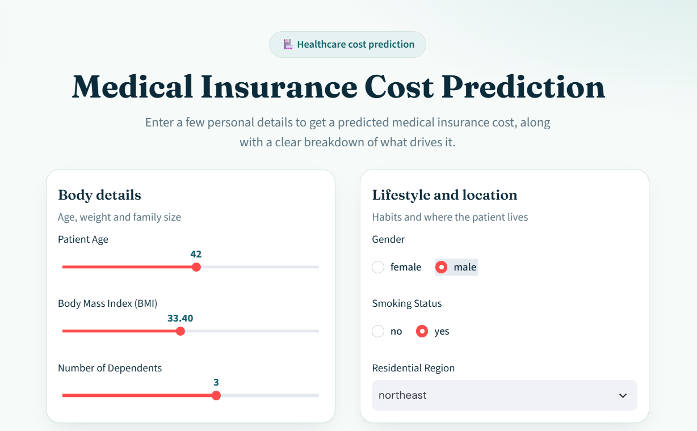
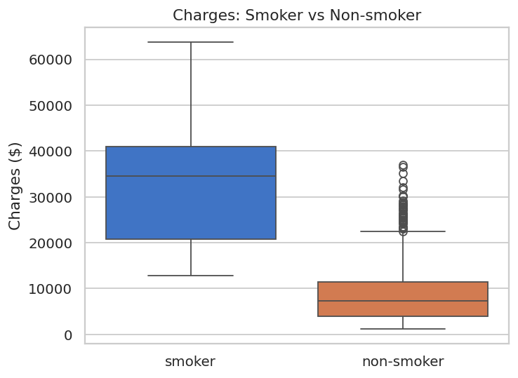
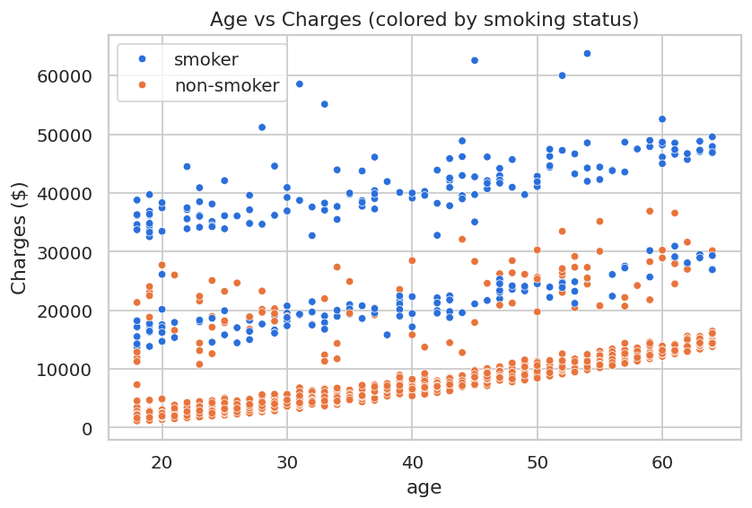
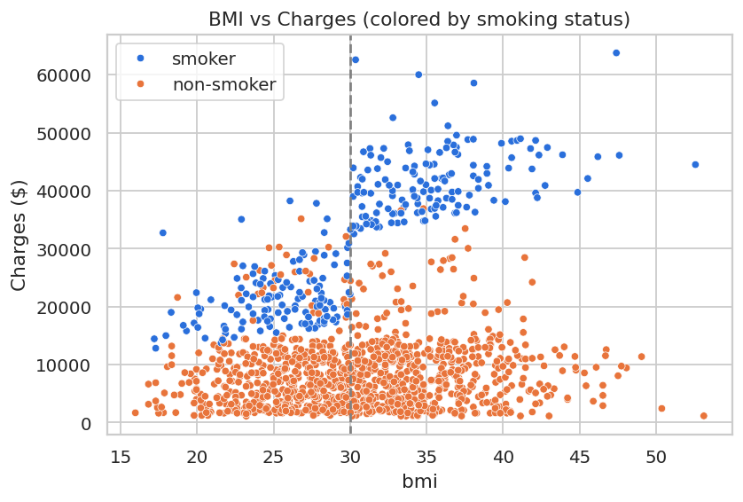
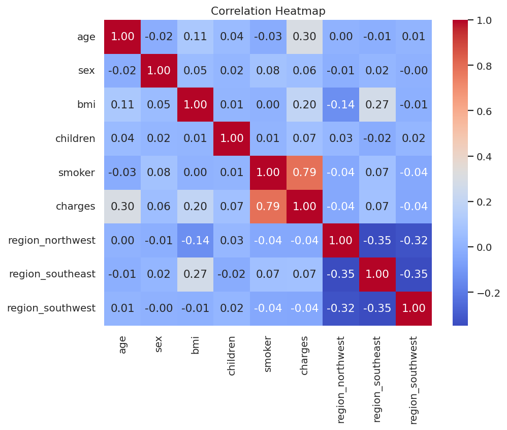
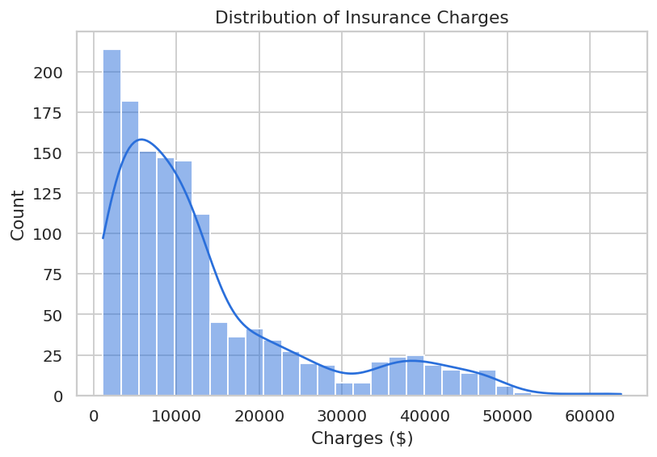
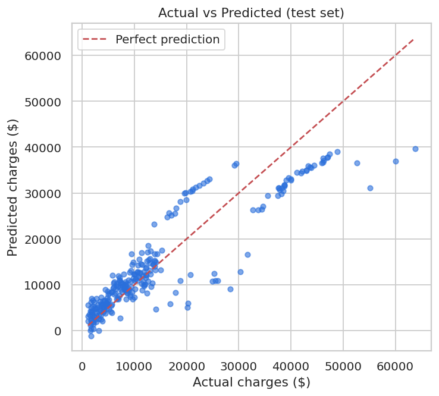
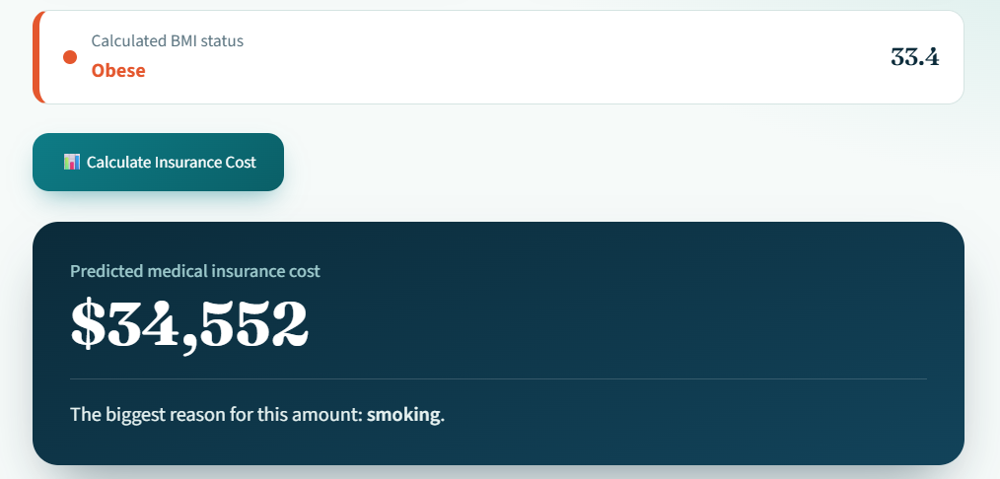
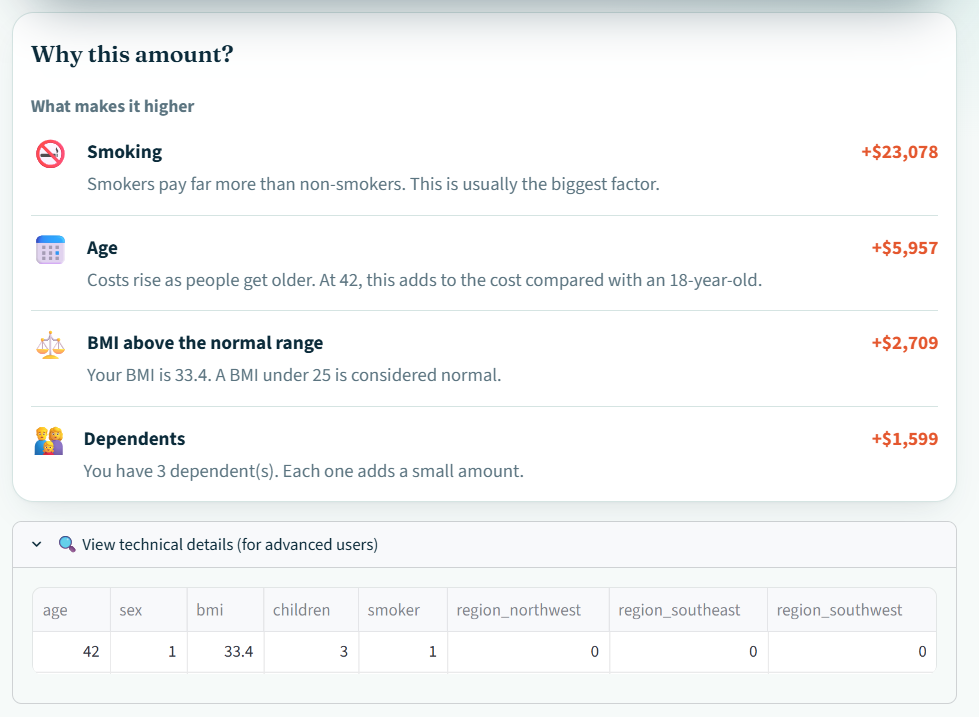

# 🏥 Medical Insurance Cost Prediction

A machine learning project that predicts the medical insurance cost of a person from age, BMI, number of children, gender, smoking status and region, using **Multiple Linear Regression**. The model is wrapped in a web app anyone can try.

**🔗 Live demo:** [https://medical-insurance-cost-predictor-2026.streamlit.app](https://medical-insurance-cost-predictor-2026.streamlit.app)



---

## Table of Contents

1. [Problem Statement](#problem-statement)
2. [Dataset](#dataset)
3. [Project Structure](#project-structure)
4. [Workflow](#workflow)
5. [Key Findings from EDA](#key-findings-from-eda)
6. [Model and Training](#model-and-training)
7. [Evaluation Results](#evaluation-results)
8. [Sample Predictions](#sample-predictions)
9. [Web App Screenshots](#web-app-screenshots)
10. [Run Locally](#run-locally)
11. [Limitations](#limitations)
12. [Future Improvements](#future-improvements)

---

## Problem Statement

Insurance companies need to estimate how much a customer is likely to cost. This project builds a **regression model** that estimates the individual medical charges billed by health insurance from basic personal details, and shows which factors drive the cost the most.

## Dataset

* **Name:** Medical Cost Personal Datasets
* **Source:** [Kaggle: mirichoi0218/insurance](https://www.kaggle.com/datasets/mirichoi0218/insurance) (originally from Brett Lantz, *Machine Learning with R*)
* **Format:** CSV (`insurance.csv`)
* **Size:** 1,338 rows and 7 columns (1,337 rows after removing one duplicate)

| Column | Type | Description |
|---|---|---|
| `age` | int | Age of the person (18 to 64) |
| `sex` | text | female or male |
| `bmi` | float | Body Mass Index |
| `children` | int | Number of children covered (0 to 5) |
| `smoker` | text | yes or no |
| `region` | text | northeast, northwest, southeast or southwest |
| **`charges`** | float | **Target:** individual medical costs billed by insurance |

## Project Structure

```
insurance-cost-prediction/
├── app.py                              # Streamlit prediction app
├── requirements.txt                    # Python dependencies
├── README.md
├── .gitignore
├── .streamlit/
│   └── config.toml                     # App theme
├── insurance.csv                       # raw dataset
├── insurance_cleaned.csv               # cleaned and encoded dataset (used by the app)
├── insurance_cost_prediction.ipynb     # full workflow (EDA to evaluation)
├── 01_charges_distribution.png         # EDA and evaluation charts
├── 02_smoker_vs_charges.png
├── 03_age_vs_charges.png
├── 04_bmi_vs_charges.png
├── 05_correlation_heatmap.png
├── 06_actual_vs_predicted.png
├── screenshot_app.png                 # app screenshots
├── screenshot_prediction.png
└── screenshot_breakdown.png
```

## Workflow

1. **Data collection and exploration:** loaded with Pandas; checked shape, data types and summary statistics.
2. **Data cleaning and preprocessing**

   * Missing values: none found.
   * Duplicates: 1 duplicate row removed (1,338 to 1,337 rows).
   * Encoding: `sex` (female = 0, male = 1) and `smoker` (no = 0, yes = 1) mapped to numbers; `region` one-hot encoded with `drop_first=True` (northeast is the base category, shown when all three region columns are 0).
3. **Exploratory data analysis:** histograms, boxplots, scatter plots, correlation analysis and outlier detection (IQR rule).
4. **Model training:** features (`X`) and target (`y = charges`) separated; 80/20 train/test split with `random_state=42`; Multiple Linear Regression trained with scikit-learn.
5. **Evaluation:** MAE, MSE, RMSE and R² on the unseen test set, compared with a baseline.
6. **Application:** Streamlit app that converts user input into the training format, predicts the cost and explains what drives it.

## Key Findings from EDA

**Smoking is by far the strongest factor.** Smokers pay about 4x more than non-smokers (about $32,050 vs $8,441 on average).



**Charges rise with age, and smoking shifts them up at every age.**



**BMI matters mainly for smokers.** Among smokers, a BMI of 30 or above doubles the average cost (about $41,558 vs $21,363). For non-smokers the difference is small (about $8,856 vs $7,977).



**Correlation with charges:** smoker 0.79, age 0.30, BMI 0.20; sex, children and region are all below 0.08.



**Other observations**

* Charges are right-skewed (mean about $13,279 vs median about $9,386).
* 139 high-cost outliers exist, 136 of them smokers. They are real cases, so they were kept.



## Model and Training

* **Algorithm:** Multiple Linear Regression (`sklearn.linear_model.LinearRegression`)
* **Why:** the target is a continuous number, and Linear Regression is a simple, interpretable model. Its coefficients let the app explain how much each factor adds to the predicted cost.
* **Split:** 1,069 training rows and 268 test rows.

Learned coefficients (effect on charges, other features held constant):

| Feature | Coefficient |
|---|---|
| smoker | +23,077.76 |
| children | +533.01 |
| bmi | +318.70 |
| age | +248.21 |
| sex (male) | -101.54 |
| region_northwest | -391.76 |
| region_southwest | -659.14 |
| region_southeast | -838.92 |
| *intercept* | -11,092.65 |

## Evaluation Results

Measured on the **test set** (268 unseen records):

| Metric | Value | Meaning |
|---|---|---|
| MAE | 4,177.05 | Average prediction error in dollars |
| MSE | 35,478,020.68 | Average squared error |
| RMSE | 5,956.34 | Typical error, penalizing large mistakes more |
| R² | 0.8069 | The model explains about 81% of the variation in charges |

* Training R² is 0.73 and test R² is 0.81. The two are close, so the model is **not overfitting**.
* A baseline that predicts the average charge for everyone gets MAE = 9,862 and R² = 0.00, so the model cuts the error by more than half.
* About 70% of test predictions are within $5,000 of the actual charge.



## Sample Predictions

| Age | BMI | Children | Gender | Smoker | Region | Predicted cost |
|---|---|---|---|---|---|---|
| 25 | 22.0 | 0 | male | no | northeast | $2,022.51 |
| 45 | 35.0 | 2 | female | yes | southeast | $34,536.25 |
| 60 | 28.0 | 1 | male | yes | northwest | $35,841.10 |

## Web App Screenshots

The app takes the person's details and returns the predicted cost. A **"Why this amount?"** section shows what raises the cost (for example smoking, age, BMI, dependents) and what keeps it low. Each amount is calculated from the model by changing one input and predicting again.

| Prediction | Breakdown |
|---|---|
|  |  |

## Run Locally

```bash
# 1. Clone the repository
git clone https://github.com/lakg3104-jpg/insurance-cost-prediction.git
cd insurance-cost-prediction

# 2. Install dependencies
pip install -r requirements.txt

# 3. Run the app
python -m streamlit run app.py
```

To reproduce the analysis, install the notebook libraries and run all cells of `insurance_cost_prediction.ipynb`:

```bash
pip install pandas numpy matplotlib seaborn scikit-learn jupyter
jupyter notebook insurance_cost_prediction.ipynb
```

## Limitations

* **Simple linear model:** it cannot capture that BMI affects smokers much more than non-smokers (an interaction), so it **underestimates high charges**, mostly for smokers with high BMI. Average error is about $9,054 for smokers vs about $2,770 for non-smokers.
* **Unrealistic values at the extremes:** very young, low-BMI non-smokers can get very low estimates (for example, a 19-year-old female non-smoker with BMI 24 from the southwest gets about $613), because a straight-line formula is less accurate at the edges of the data.
* **Skewed target and outliers:** high charges are rare and hard to predict.
* **Small dataset:** 1,337 records, only six input features, and no medical history. The model should not be used for real pricing or financial decisions.
* **Limited input range:** the app only accepts values within the range of the training data (age 18 to 64, BMI 15 to 55, children 0 to 5).

## Future Improvements

* Add an interaction feature (smoker x BMI or smoker x obese flag). A quick test with a `smoker x (BMI >= 30)` feature raised the test R² from 0.81 to about 0.91.
* Try a log transformation of `charges` and tree-based models (Random Forest, Gradient Boosting).
* Use cross-validation for more reliable performance estimates.

## Author

**LAIBA ALI** | [LinkedIn](https://www.linkedin.com/in/laiba-ali-864a113) | [GitHub](https://github.com/lakg3104-jpg)
